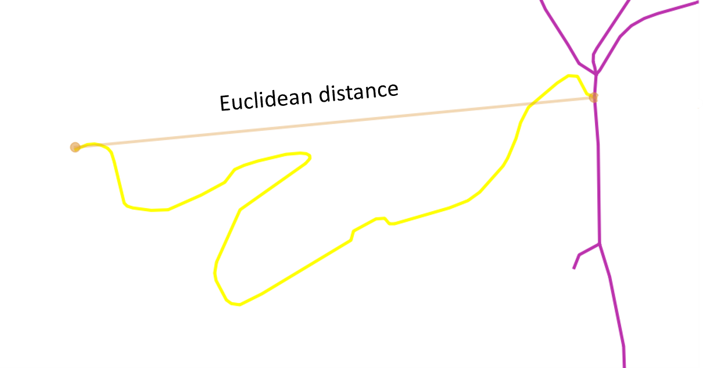
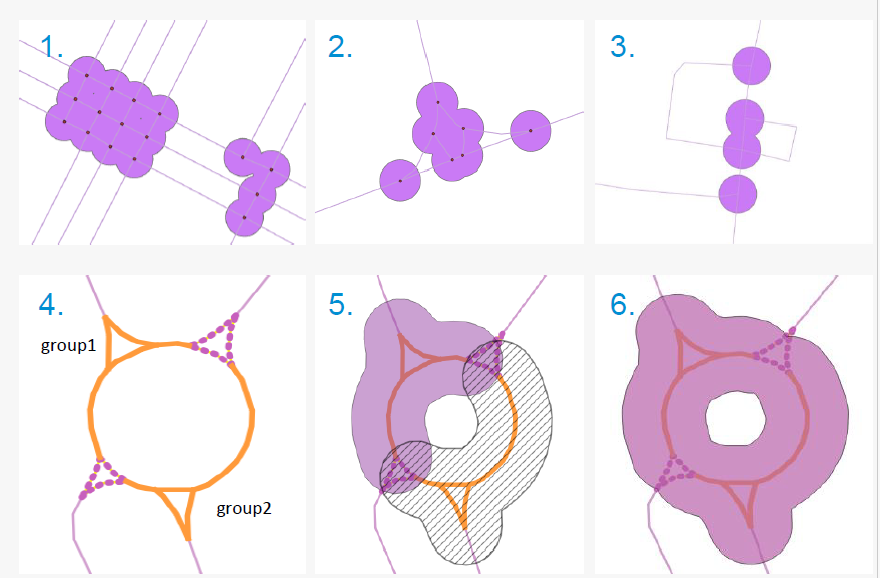

# Road Network Arc & Intersection Processing

This project processes and integrates road network data to support the
analysis and classification of road segments according to safety and
infrastructure criteria. It provides a reproducible workflow for
transforming a raw road dataset into structured arcs and intersections,
deriving relevant indicators for further analysis.

> **Data note:** the road network, public-transport, and elevation data
> used with this pipeline belong to a third party and are **not**
> included in this repository. Only the processing code is published
> here; see [Input data](#input-data) for what you need to supply to run
> it yourself.

## Input data

The input is **BDTRE**, the Piedmont Region's geo-topographic database.
It contains one record per road segment, each with a Linestring geometry
and a set of descriptive attributes, and a unique identifier per record.
A roundabout in the source geopackage next to the corresponding satellite image is shown below.


The goal is to turn these raw segments into **arcs** — individual roads,
or combinations of roads, that connect intersections at one or both
ends — and to identify **nodes**, the intersections themselves: points
where three or more road segments meet. Working at this level simplifies
the road graph by merging segments that aren't actually separated by a
real intersection at either end.

## Building arcs

To build the arcs:

- The endpoints of every segment are extracted and their occurrences are
  counted. Points that occur three or more times are identified as
  intersections.
- A small buffer is created around each intersection. Roads that
  intersect this buffer are trimmed, and the updated geometry is saved,
  with the remaining attributes aggregated according to the rules defined by third part.


## Public transport (TPL)

A `has_public_transport` flag is added to the arcs to indicate whether an
arc carries a public transportation line. This information comes from a
public-transport route dataset (for example, derived from a GTFS feed).
The challenge is that the road network and the public-transport network
don't perfectly overlap. In the figure below, the transit route and the
road network follow the same street but don't share geometry:


This misalignment means a buffer has to be drawn around the transit
route to catch the corresponding road — but a wide enough buffer also
catches side roads and alleys that don't actually carry the line,
leading to incorrect assignments (blue polygon is the buffer around the main road):


To address this:

- Both datasets are aligned to the same coordinate reference system, and
  a buffer is created around the transit lines to capture the arcs that
  intersect or lie close to them. A spatial index is used so the check
  only involves nearby arcs.
- To filter out the side arcs (yellow segments in the figure below), the connectivity of their endpoints is
  checked. Side roads typically have only one end connected to the rest
  of the network, while the road actually carrying the line is connected
  at both ends. Arcs with both endpoints connected are flagged as
  carrying public transport.

  

## Altitude

An average altitude is assigned to each arc: the first and last points
of the line are extracted, and the altitude at those points is sampled
from a digital elevation raster and averaged.


## Tortuosity

Tortuosity is the ratio of an arc's length to the Euclidean distance between its start and end points. It is computed from the arc's first and last points and its real length, giving a measure of how much the arc deviates from a straight path.



## Intersection nodes

Nodes — the intersections where three or more arcs converge — are
categorized into three groups:

- **Roundabout nodes** — nodes representing a roundabout made up of road
  segments tagged as roundabout geometry (left figure).
- **Simple nodes** — nodes formed by more than two road segments that
  are not part of a roundabout.
- **Grouped simple nodes** — simple nodes linked through intermediate
  nodes, forming a connected group where each consecutive pair is within
  a short distance of each other (right figure; after processing steps green nodes are defined as simple and yellow nodes defined to be grouped simple nodes).

<p align="center">
  
  
</p>

The eventual goal of this classification is to assign point-based
records — such as recorded incidents — onto the intersections.

### Roundabout nodes

In the source data, roundabout labels are not perfectly labeled (missing or wrong assignments), which
complicates the categorization. To group roundabout segments and assign a unique ID to each roundabout:

- A spatial indexing method is then used to efficiently identify neighboring road segments. These segments are then represented in a graph, where each road segment corresponds to a node. Connections between road segments are established based on their geometric proximity, if they touch or intersect.
- Once the graph is constructed, connected components are identified, representing groups of road segments that together form a complete roundabout or part of it.
- A buffer is created around each group of road segments, and the unary_union function is used to merge intersecting buffers into unique polygons. This process helps include some missing roads that are part of the roundabout but were not correctly indicated as such.



### Simple and grouped simple nodes

Nodes are classified based on their spatial relationship with nearby
road segments: each node is associated with the intersecting arcs and
their endpoints, and a distance-based proximity check determines whether
the node is isolated or connected to neighboring nodes.

Isolated nodes are classified as simple nodes, while spatially connected nodes are further analyzed using connected-component analysis to identify groups of nodes that form a single logical network node. The resulting grouped nodes are assigned unique identifiers, with their associated road segments consolidated accordingly.

## Repository structure

```
road-network-arc-processing/
├── README.md
├── requirements.txt
├── images/                 # figures used in this README
└── src/
    ├── config.py            # paths, column names, constants — edit before running
    ├── utils.py             # shared geometry / attribute-aggregation helpers
    ├── build_arcs.py        # builds arcs, then adds TPL, altitude, tortuosity
    └── classify_intersections.py   # roundabout / simple / grouped-simple nodes
```

## Installation

```bash
python -m venv .venv
source .venv/bin/activate   # on Windows: .venv\Scripts\activate
pip install -r requirements.txt
```

## Usage

1. Edit `src/config.py` with the paths to your own road segments,
   public-transport routes, and elevation raster (see [Input
   data](#input-data)).
2. Run the two scripts in order from the `src/` directory:

```bash
cd src
python build_arcs.py
python classify_intersections.py
```

`build_arcs.py` produces the arc dataset (with the public-transport
flag, altitude, and tortuosity already added). `classify_intersections.py`
reads that dataset together with the raw segment layer to detect and
classify intersections, and writes the intersection-node dataset.
